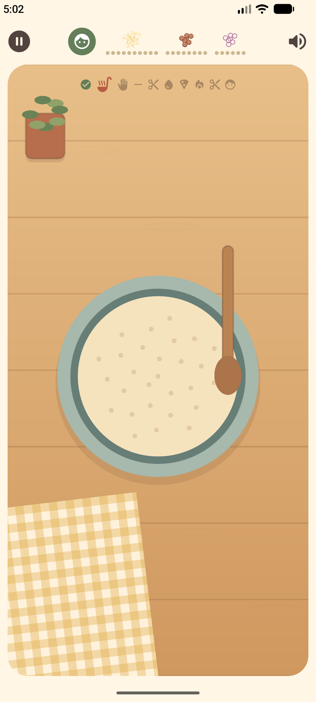
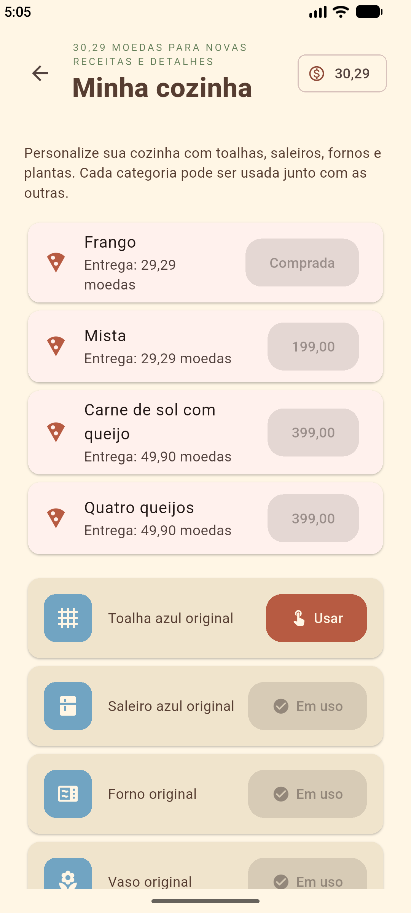

# Pizza Game 🍕

Uma cozinha aconchegante para preparar pizzas doces e salgadas no seu ritmo, com gestos de toque ou mouse. Disponível para Android e Linux.

## O que tem no jogo

- Misture a massa com animações, corte ingredientes, espalhe a cobertura, asse e sirva a pizza. Depois do forno, a imagem pronta acompanha o corte e a entrega.
- Utensílios acompanham a mão, com ajuda nos cortes e dicas animadas.
- Potes cheios de ingredientes preparados e coberturas espalhadas naturalmente, com limite de quantidade.
- Nove sabores com imagens próprias: marguerita, calabresa, chocolate com morango, frango, mista, carne de sol com queijo, quatro queijos, camarão e frango com catupiri.
- Três receitas iniciais e novas receitas para comprar com moedas das entregas.
- Pedidos aleatórios entre os sabores disponíveis, opção de recusar e receber outro, avaliações em estrelas e modo livre.
- Loja de saleiros, fornos, toalhas e plantas, com prévia antes de comprar.
- Progresso, saldo e compras salvos; música e efeitos com volume ajustável.

## Saiba mais

- [Como compilar e testar](docs/COMPILAR_E_TESTAR.md)
- [Arquitetura do projeto](docs/ARQUITETURA.md)
- [Créditos dos recursos](ASSETS.md)
